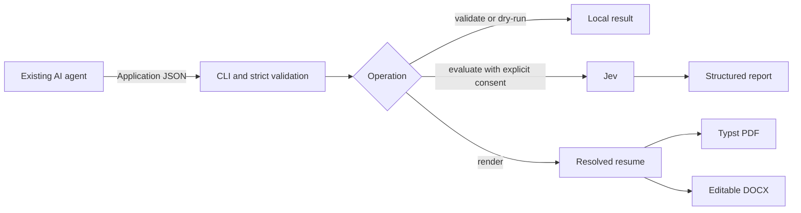

# Repository Guidelines

## Project Overview

`resume-toolkit` is a local Bun/TypeScript CLI for validating agent-supplied resume data, optionally evaluating it with Jev, and exporting PDF/DOCX. The connected AI agent owns career context, tailoring, and revisions; the toolkit does not own a profile database or application workflow. The agent skill lives in `skills/resume-toolkit/SKILL.md`.

**Current state:** The local CLI includes `schema`, `validate`, `lint`, `evaluate`, and `render`; strict schema version 1 supports optional `entry.location`, `entry.stack` on experience/projects, certification `entry.expires`, optional header-link URLs, and `resume.sectionOrder`. The skill documents tailoring, review/fix, and render-only modes. Lint findings are warnings and do not change validation status/evidence linkage or block export. The evaluation dry-run, local mock failure cases, and synthetic revision-to-export workflow are verified; live Jev answer/model/usage and cancellation remain unverified.

## Architecture & Data Flow

The planned flow is:



Use one versioned `Application` snapshot as input. Strict Zod schemas define its contract; deterministic validation checks structure and evidence references before side effects. Load/hash input once and do not mutate it. Evaluation is optional and requires explicit consent; validation and rendering must work offline. Both renderers consume the same resolved resume content.

## Key Directories

- `docs/` — product boundaries, contracts, implementation phases, and research.
- `src/` — CLI, strict schemas, validation/lint/I/O, resolved resume/design, PDF/DOCX serializers, and evaluation.
- `assets/` — trusted Typst template and licensed local fonts.
- `skills/resume-toolkit/` — skill, writing guide, and CLI/data/artifact references.
- `examples/` — synthetic application and lint fixtures.

## Development Commands

```sh
bun install --frozen-lockfile
bun x tsc --noEmit
bun test
bun run src/cli.ts <command> [flags]
```

The package declares the `resume-toolkit` executable in its `bin` field; `bun run src/cli.ts <command> [flags]` is for development inside the repository. There are no `package.json` scripts or build command; `resume-toolkit lint` checks resume content, not TypeScript source. Remote evaluation still requires explicit consent and a configured API key. See `docs/prototype-plan.md` for flags and output contracts.

## Code Conventions & Common Patterns

- Private ESM TypeScript, Bun-first. Follow `tsconfig.json`: strict mode, `noEmit`, `noUncheckedIndexedAccess`, and `verbatimModuleSyntax` (`import type` for type-only imports). `.ts` extension imports are allowed.
- Prefer plain functions, direct imports, and explicit format dispatch. Avoid generic renderer/evaluator interfaces, provider frameworks, and unnecessary dependency injection.
- Keep Zod schemas authoritative and strict: reject unknown fields rather than silently stripping them. Preserve evidence IDs on factual claims; never imply evidence proves truth.
- Keep each operation bound to its supplied snapshot. Validate before network or file writes, keep local rendering independent of Jev, and preserve existing outputs on failures.
- There is no generic error framework. Use module-local result types, validate before side effects, sanitize CLI diagnostics, and load the Jev SDK only for authorized live evaluation.

## Important Files

- `package.json`, `bun.lock` — exact dependencies and Bun lockfile; package declares the `resume-toolkit` executable, with no package scripts.
- `src/application/` — schema, snapshot I/O, validation, and lint.
- `src/render/`, `src/resume/`, `src/evaluation/` — export, resolved-content/design, and evaluation modules.
- `tests/` — Bun behavior tests, kept separate from runtime source.
- `skills/resume-toolkit/writing-guide.md` and `skills/resume-toolkit/references/` — writing, CLI, data, and artifact-review guidance.
- `scripts/setup.sh` copies the canonical skill source into agent-specific destinations; edit `skills/resume-toolkit/`, never installed copies.
- `examples/lint-bad-application.json`, `examples/lint-good-application.json` — synthetic lint/layout fixtures.
- `docs/writing-guide-research.md` — source basis for the skill's editorial guidance.
- `tsconfig.json` — TypeScript compiler settings.
- `docs/prototype-plan.md` — concrete current specification, implementation layout, CLI contracts, and QA gates.
- `docs/agent-tool-direction.md` — product boundary and revised architectural decisions.
- `docs/research-synthesis.md` — earlier research; its separate profile/job/draft files and Playwright renderer are superseded by the newer plan.
- `docs/prd-idea.md` — initial research brief, not the current implementation contract.

## Runtime/Tooling Preferences

Use Bun and `bun.lock`; Bun 1.4.2 is the version observed in the plan. Dependencies are pinned in `package.json`: Zod 4 for validation, `@typesafe-ai/sdk` for Jev, and `docx` for editable DOCX. PDF generation uses the external Typst CLI (0.15.1 observed), bundled Apache-2.0 Caladea (metric-compatible with Cambria), and licensed fallback fonts. DOCX output declares Cambria; recipient viewers may substitute it. This is browserless; do not reintroduce Playwright/Chromium from the older research proposal. Keep API keys and private application data out of version control (`.gitignore` excludes `.env*`).

## Testing & QA

The test runner is Bun's built-in `bun:test`; focused behavior suites cover validation, rendering, and evaluation. Routine tests make no external Jev calls; the evaluation suite uses a loopback mock HTTP server. Cover strict input/reference validation, minimized egress, no mutation, and safe failure behavior.

Export checks inspect actual artifacts: PDF text, links, fonts, and page layout; DOCX native content and a manual edit/save/reopen in Writer have been exercised. Headless conversion alone does not prove DOCX editability. Live Jev checks require explicit authorization and synthetic data; never replace them with fabricated success results. Documentation checks are not runtime verification.
