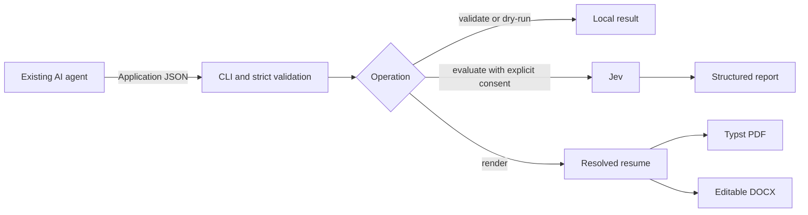

# Repository Guidelines

## Project Overview

`resume-toolkit` is planned as a local Bun/TypeScript CLI and agent skill for validating agent-supplied resume data, optionally evaluating it with Jev, and exporting PDF/DOCX locally. The connected AI agent owns career context, tailoring, and revisions; the toolkit does not own a profile database or application workflow.

**Current state:** this repository contains package/configuration files and planning docs only. `src/`, tests, scripts, assets, and the skill are not implemented yet. The next planned work is Phase 1 (contracts and validation); Phase 0 has local feasibility checks, but its DOCX edit/reopen and authorized live Jev checks remain open.

## Architecture & Data Flow

The planned flow is:



Use one versioned `Application` snapshot as input. Strict Zod schemas define its contract; deterministic validation checks structure and evidence references before side effects. Load/hash input once and do not mutate it. Evaluation is optional and requires explicit consent; validation and rendering must work offline. Both renderers consume the same resolved resume content.

## Key Directories

- `docs/` — product boundaries, contracts, implementation phases, and research.
- Planned `src/` — CLI, schemas, validation/I/O, resolved resume/design, PDF/DOCX serializers, and evaluation; create modules only when implementing real behavior.
- Planned `assets/` — trusted Typst template and licensed local fonts.
- Planned `skills/resume-toolkit/` — agent instructions.
- Planned `examples/` — synthetic application fixtures only.

## Development Commands

```sh
bun install --frozen-lockfile
bun x tsc --noEmit                 # once TypeScript source exists
bun test                           # once tests exist
bun run src/cli.ts <command> [flags] # planned development entry point
```

There are currently no `package.json` scripts, source entry point, tests, build command, linter, or formatter. Do not assume `npm`, a published `resume-toolkit` executable, or configured build/test scripts. The planned CLI operations are `schema`, `validate`, `evaluate`, and `render`; see `docs/prototype-plan.md` for flags and output contracts.

## Code Conventions & Common Patterns

- Private ESM TypeScript, Bun-first. Follow `tsconfig.json`: strict mode, `noEmit`, `noUncheckedIndexedAccess`, and `verbatimModuleSyntax` (`import type` for type-only imports). `.ts` extension imports are allowed.
- Prefer plain functions, direct imports, and explicit format dispatch. Avoid generic renderer/evaluator interfaces, provider frameworks, and unnecessary dependency injection.
- Keep Zod schemas authoritative and strict: reject unknown fields rather than silently stripping them. Preserve evidence IDs on factual claims; never imply evidence proves truth.
- Keep each operation bound to its supplied snapshot. Validate before network or file writes, keep local rendering independent of Jev, and preserve existing outputs on failures.
- No established source-level async/error-handling patterns exist yet. Follow the planned boundaries: local file/process work in the CLI path, Jev SDK only for authorized live evaluation, structured failures, and sanitized diagnostics.

## Important Files

- `package.json`, `bun.lock` — exact dependency versions and Bun lockfile; package scripts are not configured.
- `tsconfig.json` — TypeScript compiler settings.
- `docs/prototype-plan.md` — concrete current specification, implementation layout, CLI contracts, and QA gates.
- `docs/agent-tool-direction.md` — product boundary and revised architectural decisions.
- `docs/research-synthesis.md` — earlier research; its separate profile/job/draft files and Playwright renderer are superseded by the newer plan.
- `docs/prd-idea.md` — initial research brief, not the current implementation contract.

## Runtime/Tooling Preferences

Use Bun and `bun.lock`; Bun 1.4.2 is the version observed in the plan. Dependencies are pinned in `package.json`: Zod 4 for validation, `@typesafe-ai/sdk` for Jev, and `docx` for editable DOCX. PDF generation is planned through the external Typst CLI (0.15.1 observed) and local licensed Carlito fonts. This is browserless; do not reintroduce Playwright/Chromium from the older research proposal. Keep API keys and private application data out of version control (`.gitignore` excludes `.env*`).

## Testing & QA

The planned runner is Bun's built-in `bun:test`; no test files or coverage target exist yet. Add a few behavior-focused tests alongside the owning modules when they protect consumer-visible invariants. Routine tests should be offline and must not call Jev. Cover strict input/reference validation, no mutation, and safe failure behavior as those modules arrive.

Export checks must inspect actual artifacts: PDF text, links, fonts, and page layout; DOCX native content and a manual edit/save/reopen in Writer. Headless conversion alone does not prove DOCX editability. Live Jev checks require explicit authorization and synthetic data; never replace them with fabricated success results. Documentation checks are not runtime verification.
